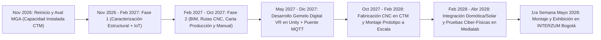

# Propuesta de Formulación MGA / SENNOVA: Geodome Smart (Revisión Lunes 9 de Noviembre de 2026)

> [!IMPORTANT]
> **Foco de Evaluación para el Lunes 9 de Noviembre de 2026:**
> La evaluación se centrará en **Objetivos, Justificación, Viabilidad Presupuestal/Espacial (Prototipo Funcional a Escala)** y la demostración contundente de que el **Centro Tecnológico del Mobiliario (CTM - Itagüí / Regional Antioquia)** posee **100% la Capacidad Instalada** (infraestructura física, maquinaria CNC, Medialab y talento humano) para ejecutar el proyecto y llevarlo a **INTERZUM Bogotá (Primera semana de Mayo de 2028)**.

---

## 1. Justificación Actualizada (Con Énfasis en Capacidad Instalada y Prototipo a Escala)

### 1.1. Sinergia Ciber-Física: Estructura de Madera + Automatización Abierta (IoT)
A diferencia de las intervenciones tradicionales que abordan la estructura en madera como un elemento meramente estático y agregan dispositivos domóticos como "parches" posteriores, **Geodome Smart** concibe la edificación como un **sistema ciber-físico integrado desde el diseño (BIM)**. Los marcos rígidos y nodos de ensamble a tope incorporan nativamente las canalizaciones, nichos y alojamientos para microcontroladores **ESP32**, sensores ambientales y actuadores controlados mediante **Home Assistant / ESPHome**. Esto permite gestionar de forma autónoma variables críticas de habitabilidad:
- **Ventilación cenital automática** por estratificación térmica.
- **Seguridad contra incendios** mediante sensores térmicos y de contacto en el ducto de evacuación de la chimenea/estufa de leña.
- **Eficiencia energética y autonomía** mediante el monitoreo del sistema solar fotovoltaico y banco de baterías.
- **Control de acceso inteligente** y gestión ambiental para huéspedes en zonas rurales desconectadas.

### 1.2. Transición Estratégica hacia un Prototipo Funcional a Escala y Gemelo Digital VR en Unity
Originalmente se contempló una estructura a escala 1:1; sin embargo, bajo criterios de **eficiencia presupuestal, optimización del uso de espacios en los talleres del CTM y viabilidad logística de transporte desde Medellín/Itagüí hacia Corferias (Bogotá)** para su montaje en la **primera semana de mayo de 2028 (INTERZUM Bogotá)**, se define el desarrollo de un **Prototipo Físico Funcional a Escala (Demostrador Tecnológico Ciber-Físico)** articulado en tiempo real con un **Gemelo Digital Inmersivo en Realidad Virtual (desarrollado en Unity)**.

Esta decisión técnica permite:
1. **Validar el 100% de las implementaciones constructivas y tecnológicas:** El prototipo a escala conserva la geometría exacta de los marcos rígidos, los nodos de ensamble a tope mecanizados por CNC, las canalizaciones ocultas, los paneles de cerramiento y el ecosistema completo de sensores/actuadores ESP32 operativos.
2. **Viabilizar la exhibición ferial de alto impacto en INTERZUM Bogotá 2028:** El visitante podrá interactuar físicamente con los sensores y actuadores del domo a escala (simulando cambios de temperatura, humo en chimenea, generación solar y apertura de ventanales) mientras experimenta simultáneamente la habitabilidad a **escala 1:1 en Realidad Virtual mediante Unity**, sincronizado bidireccionalmente por MQTT/WebSockets con el hardware real.
3. **Maximizar la relación beneficio-costo en los talleres de formación:** Reduce el consumo de materia prima maderable y elimina costos de cimentación pesada en sitio, concentrando los recursos en la precisión del mecanizado CNC, la electrónica embebida y el desarrollo del software del Gemelo Digital.

### 1.3. Demostración de Capacidad Instalada en el CTM (SENA Regional Antioquia)
El proyecto cuenta con **plena viabilidad técnica y operativa inmediata**, respaldada por la capacidad instalada existente en el **Centro Tecnológico del Mobiliario (CTM - Itagüí)**:

| Componente de Capacidad Instalada | Infraestructura Disponible en el CTM | Rol en el Proyecto Geodome Smart |
| :--- | :--- | :--- |
| **Fabricación Digital y Carpintería Avanzada** | Talleres de mecanizado CNC (routers CNC de alta precisión), taller de ebanistería, corte, canteo y ensamble de estructuras en madera. | Mecanizado de marcos rígidos a escala, bloques de unión, ensambles a tope y fresado de nichos/canalizaciones embebidas para sensores. |
| **Laboratorio de Innovación y Electrónica (Ambiente 107 - Medialab)** | Estaciones de desarrollo de alto rendimiento (Workstations para BIM y motores gráficos Unity), visores de Realidad Virtual (VR), instrumentación electrónica, servidores locales para Home Assistant y bancos de pruebas IoT (ESP32/MQTT). | Diseño de la arquitectura lógica domótica, programación de nodos ESPHome, desarrollo del Gemelo Digital VR en Unity y pruebas de pre-ensamble ciber-físico. |
| **Equipo Interdisciplinario SENNOVA e Instructores** | **W. Tibavija, A. Hassan, A. Londoño** (Diseño estructural, BIM, CNC y procesos constructivos en madera) y **A. Zapata, V. Cardona** (Medialab, Domótica IoT, Energía Solar y Gemelo Digital VR en Unity). | Ejecución técnica directa sin dependencia de consultoría externa, integrando aprendices de Diseño de Mobiliario, Construcción y Automatización/Sistemas. |

---

## 2. Objetivos Revisados y Alineados (Enfoque Prototipo Funcional a Escala + Unity VR + Capacidad Instalada CTM)

### 2.1. Objetivo General
> **Desarrollar un modelo de operación inteligente para infraestructuras ecoturísticas modulares mediante la integración de flujos de fabricación digital (BIM/CNC), un prototipo físico funcional a escala con domótica abierta (IoT) y un Gemelo Digital inmersivo en Realidad Virtual (Unity), aprovechando la capacidad instalada del Centro Tecnológico del Mobiliario (CTM) para fortalecer las competencias en Construcción 4.0 y validar su transferencia tecnológica hacia el sector productivo en INTERZUM Bogotá 2028.**

### 2.2. Objetivos Específicos

1. **Objetivo Específico 1 (Caracterización Estructural e IoT):**
   > *Caracterizar las variables de diseño estructural de marcos rígidos (nodos de ensamble a tope) y los requerimientos técnicos de automatización (IoT) y autonomía solar, mediante el análisis geométrico-estructural y la evaluación de protocolos de hardware abierto (ESP32 / Home Assistant) en el Medialab del CTM, para definir los parámetros técnicos de integración ciber-física tanto a escala real como en el prototipo funcional a escala.*

2. **Objetivo Específico 2 (Diseño BIM, Protocolos CNC y Gemelo Digital VR en Unity):**
   > *Diseñar el modelo de infraestructura inteligente basado en flujos de trabajo BIM, que articule los protocolos de mecanizado CNC (incluyendo nichos y canalizaciones embebidas) con la arquitectura abierta de domótica y el desarrollo del Gemelo Digital interactivo en Realidad Virtual (Unity), garantizando la sincronización bidireccional de datos entre el modelo digital 1:1 y el hardware físico.*

3. **Objetivo Específico 3 (Prototipado Funcional a Escala, Validación y Exhibición en INTERZUM 2028):**
   > *Construir y validar en los talleres y laboratorios del CTM un prototipo físico funcional a escala del domo ecoturístico inteligente, integrando el sistema domótico autónomo, la gestión energética solar y su enlace en tiempo real con el Gemelo Digital VR (Unity), estableciendo los protocolos de transferencia tecnológica y su puesta en marcha para exhibición en INTERZUM Bogotá (Mayo 2028).*

---

## 3. Reajuste de Actividades de Producción y Nuevas Actividades Sugeridas (15 MGA + Nuevas de Escala/Unity/Interzum)

Se mantienen las **15 actividades estructurales de la Cadena de Valor MGA** ajustadas al alcance del prototipo funcional a escala y se incorporan sub-actividades clave para el **Gemelo Digital en Unity** y la **Logística de Exhibición en INTERZUM Bogotá (Mayo 2028)**:

| ID | Objetivo | Producto MGA | Actividad (Ajustada a Prototipo a Escala + Unity VR) | Fase Acta 02 Relacionada | Responsables | Cronograma Reajustado (Nov 2026 – May 2028) |
| :--- | :--- | :--- | :--- | :--- | :--- | :--- |
| **A01** | OE1 | Documento técnico de especificaciones integradas (estructura + IoT) | **1. Diagnóstico de variables de confort y habitabilidad** (estratificación térmica, seguridad en chimenea, iluminación y autonomía solar). | Fase 1: Diseño y Modelado | A. Zapata, V. Cardona, W. Tibavija | Nov 2026 – Dic 2026 |
| **A02** | OE1 | Documento técnico de especificaciones integradas (estructura + IoT) | **2. Selección y benchmarking de hardware IoT abierto** (ESP32, sensores térmicos/humo/consumo, actuadores de ventanales, Home Assistant / MQTT). | Fase 4: Canalización y Domótica | A. Zapata, V. Cardona (Medialab) | Nov 2026 – Ene 2027 |
| **A03** | OE1 | Documento técnico de especificaciones integradas (estructura + IoT) | **3. Análisis estructural de marcos rígidos y factor de escalamiento** (cargas NSR-10 referenciales y factor de reducción geométrica para el prototipo a escala). | Fase 1: Diseño y Modelado | W. Tibavija, A. Hassan, A. Londoño | Dic 2026 – Ene 2027 |
| **A04** | OE1 | Documento técnico de especificaciones integradas (estructura + IoT) | **4. Definición de parámetros de integración ciber-física** (manual de nichos, canalizaciones ocultas y blindaje térmico/eléctrico en madera). | Fase 1 y Fase 4 | Equipo Total (CTM + Medialab) | Ene 2027 – Feb 2027 |
| **A05** | OE2 | Modelo digital BIM y protocolos de fabricación CNC | **5. Modelado 3D paramétrico BIM** (geometría geodésica de marcos rígidos, nodos de junta a tope, zonas húmedas y mobiliario ergonómico). | Fase 1 y Fase 6 | W. Tibavija, A. Hassan, A. Londoño, A. Zapata, V. Cardona | Feb 2027 – May 2027 |
| **A06** | OE2 | Modelo digital BIM y protocolos de fabricación CNC | **6. Diseño de nichos y canalizaciones embebidas** en los perfiles de madera y paneles de cerramiento para alojar sensores y cableado. | Fase 3 y Fase 4 | A. Zapata, V. Cardona, W. Tibavija | Abr 2027 – Jun 2027 |
| **A07** | OE2 | Modelo digital BIM y protocolos de fabricación CNC | **7. Generación de rutas de corte y mecanizado CNC (G-Code)** para el kit de partes del prototipo funcional a escala. | Fase 2: Fabricación Estructural | W. Tibavija, A. Hassan, A. Londoño | May 2027 – Jul 2027 |
| **A08** | OE2 | Modelo digital BIM y protocolos de fabricación CNC | **8. Diseño de arquitectura lógica, red IoT y banco solar a escala (MEDIALAB)** (esquemas eléctricos, MQTT, Home Assistant y gestión fotovoltaica). | Fase 4 y Fase 5 | A. Zapata, V. Cardona (Medialab) | Jun 2027 – Ago 2027 |
| **A09** | OE2 | Modelo digital BIM y protocolos de fabricación CNC | **9. Elaboración de Carta de Producción industrializada** (tiempos, secuencias de mecanizado CNC, insumos y control de calidad). | Fase 2 y Fase 3 | Equipo Total | Jul 2027 – Sep 2027 |
| **A10** | OE2 | Modelo digital BIM y protocolos de fabricación CNC | **10. Elaboración de Manual de Ensamble en seco ("Kit de Partes")** (guía paso a paso de montaje rápido para taller y feria). | Fase 2 y Fase 3 | Equipo Total | Ago 2027 – Oct 2027 |
| **A11** | OE2 | Modelo digital BIM y protocolos de fabricación CNC | **11. Desarrollo del Gemelo Digital Inmersivo en Unity (VR) + Telemetría IoT** *(Exportación BIM a Unity, programación de shaders/iluminación, interacción VR 1:1 y puente MQTT con ESP32)*. | Fase 1 y Fase 4 | A. Zapata, V. Cardona (Medialab) | May 2027 – Dic 2027 |
| **A12** | OE3 | Prototipo físico con gemelo digital y protocolo de transferencia | **12. Adecuación de base portante / plataforma modular de exhibición y cimentación a escala** *(Reemplaza excavación pesada por plataforma de deck técnico transportable con ruedas/niveladores para CTM e INTERZUM)*. | Fase 2 y Fase 6 | W. Tibavija, A. Hassan, A. Londoño | Sep 2027 – Nov 2027 |
| **A13** | OE3 | Prototipo físico con gemelo digital y protocolo de transferencia | **13. Fabricación CNC, paneles de cerramiento, mobiliario a escala y embalaje técnico** (producción en talleres del CTM y cajas de transporte tipo flight-case para Bogotá). | Fase 2, 3 y 6 | Equipo Total + Aprendices CTM | Oct 2027 – Ene 2028 |
| **A14** | OE3 | Prototipo físico con gemelo digital y protocolo de transferencia | **14. Montaje estructural del prototipo a escala (en CTM y pre-montaje ferial)** (ensamble en seco de marcos rígidos, cubierta, ventanales motorizados y deck). | Fase 2 y Fase 3 | Equipo Total | Ene 2028 – Feb 2028 |
| **A15** | OE3 | Prototipo físico con gemelo digital y protocolo de transferencia | **15. Instalación eléctrica, domótica, sistema solar, sincronización con Unity VR y despliegue en INTERZUM Bogotá** *(Pruebas en Medialab: Feb–Abr 2028; Traslado Medellín–Bogotá e instalación: 1ra semana de Mayo 2028)*. | Fase 4 y Fase 5 | A. Zapata, V. Cardona, Equipo Total | Feb 2028 – May 2028 |

---

## 4. Hitos Clave del Cronograma Reajustado (Noviembre 2026 – Mayo 2028)

